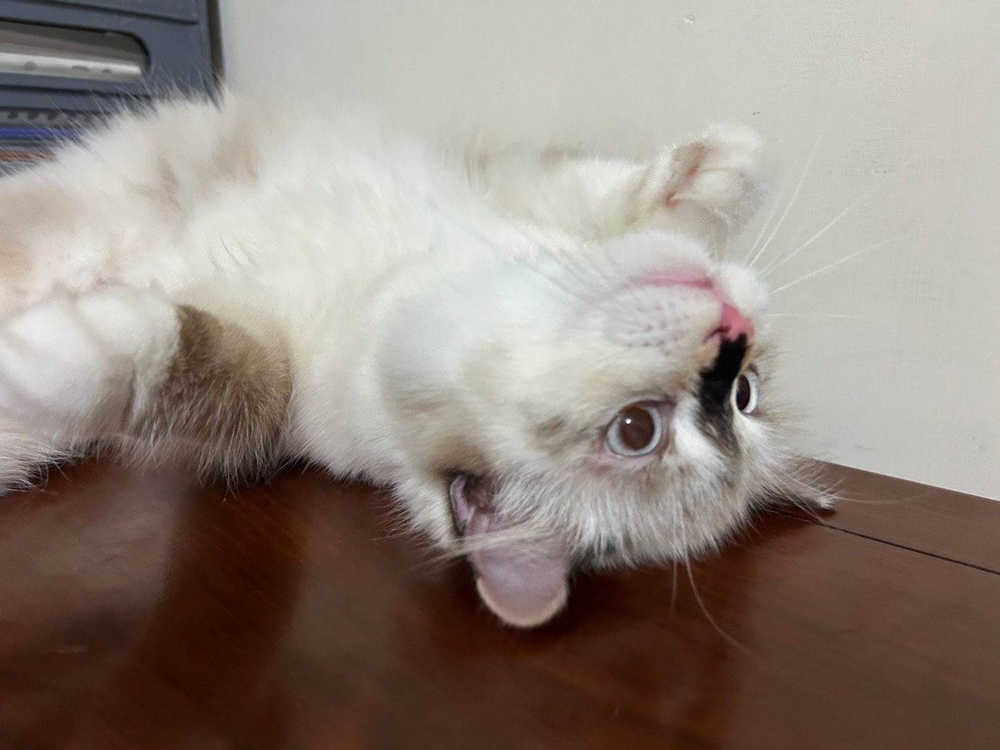

# Yu-Syuan Wu Personal Webpage

## 1. Basic Information

- **Name:** Yu-Syuan Wu
- **Department & Year:** Junior, Department of Life Science and Biotechnology
- **University:** National Taiwan Ocean University
- **Hometown:** Yilan
- **Email:** wuuuys@gmail.com
- **GitHub:** [https://github.com/your-account](https://github.com/wuuuys/abmeee)

*Personal Photo: Please insert a photo suitable for public viewing here (optional).*

---

## 2. About Me

Hello everyone, I am Wu Yu-Syuan, a third-year student majoring in Life Sciences at National Taiwan Ocean University. Driven by a strong interest in biomedicine, data science, and technology, I have developed solid foundations in both biological laboratory techniques and data analysis using R. I am committed to continuously expanding my skills in programming, statistical modeling, and AI applications to address complex biological questions.

---

## 3. Interests

- 🎵 **Music:** K-pop, Pop Music (BTS)
- 🎬 **Entertainment:** Movies, Korean Variety Shows, Character-driven Stories
- 🎨 **Creative Interests:** Creative Writing, Character Design, Fashion & Beauty
- 🧠 **Learning:** Psychology, Human Behavior, Biology & Life Sciences
- 💻 **Technology:** AI, Emerging Technologies
- 🌙 **Personal Interests:** Personality Types, Self-Reflection, Astrology

---

## 4. Skills

| Skill | Current Level | What I can do |
| :--- | :--- | :--- |
| **Python** | Beginner | Understand basic syntax, variables, conditional statements, loops, and functions |
| **GitHub** | Beginner | Create repositories, commit changes, and push code |
| **English** | Intermediate | Read English learning materials and understand general written content |

---

## 5. Projects

### Project 1 | My First Python Program
This was my first Python mini-project completed in class. Through this project, I learned the basics of Python programming, including variables, user input, and displaying output.
- **GitHub Link:** (https://github.com/wuuuys/abmeee)

### Project 2 | (Fill in by yourself)
- **Project Content:** Explore basic Python programming and apply what I have learned to a small personal project.
- **GitHub Link:** (https://github.com/wuuuys/abmeee)
---

## 6. Goals

1. Strengthen my understanding of Python programming fundamentals.
2. Learn to use Git and GitHub to manage and share my projects.
3. Develop practical skills in AI and explore its real-world applications.
4. Explore the connections between programming, psychology, and life sciences.

---

## 7. Contact

- **Email:** wuuuys@gmail.com
- **GitHub:**(https://github.com/wuuuys/abmeee)
- **Other public links (optional):** LinkedIn / Personal Portfolio / Social Media

---

## 8. A Note to My Future Self

I hope that when I look back on this page a year from now, I will have gained more knowledge, improved my programming skills, and completed projects of my own. I also hope to have a clearer understanding of my interests and how I can apply what I have learned to my future studies and career.
